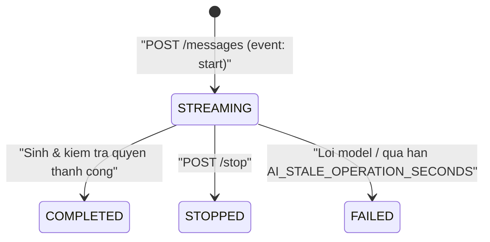
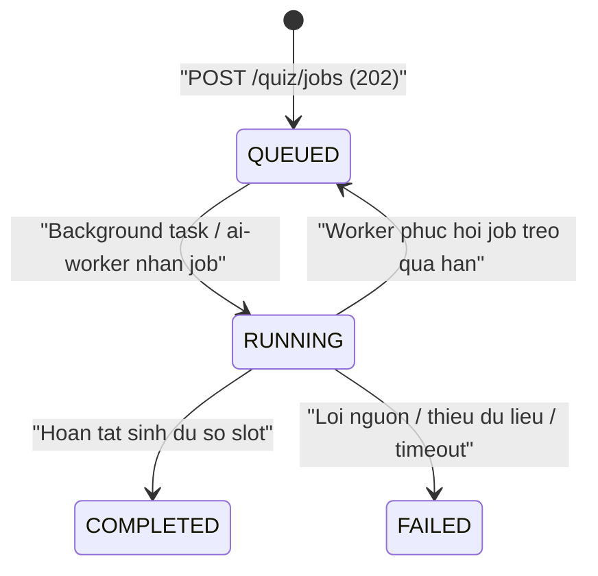

# AI Service — Thiết kế v1

**Trạng thái:** `IMPLEMENTED` · **Cập nhật:** 2026-11-22

> **Phạm vi và giới hạn nghiệm thu:** Mã nguồn `services/ai/` (`tutor`, `quiz`, `indexing`, `analytics_export`, `background_worker`, `rag_runtime`) và tích hợp proxy Web (`/api/ai/v1/*`) đã được triển khai cùng Docker Compose (`compose.full.yaml`) và kiểm thử đơn vị/hợp đồng (`pytest`). Đánh giá định lượng `QAS-06` (`>= 100` câu hỏi với mô hình GGUF thật) và consumer bất đồng bộ tự động tiêu thụ outbox `document.version.published` để nạp `/canonical` end-to-end đang chờ hoàn tất bước cấu hình và đo thực tế khi bật corpus/GGUF.

**Business Rules liên quan:** `C1`, `C2`, `C3`, `C4`, `C5`, `C6`, `D1`, `D5`, `D6`, `E5`, `F3`, `H4`, `H5`, `J4`, `O6`, `QAS-01`, `QAS-02`, `QAS-04`, `QAS-06`.

---

## 1. Phạm vi, công nghệ và ranh giới

- **Dịch vụ độc lập trong monorepo:** `services/ai/`, sử dụng Python 3.12, FastAPI, SQLAlchemy 2.x, Alembic.
- **Engine RAG dùng chung nội bộ build:** phụ thuộc `services/rag/` (`rag.generation.*`, `rag.retrieval.*`, `rag.citations.*`, `rag.packing.*`). Docker build context đặt tại `./services` với Dockerfile `ai/Dockerfile`, chỉ đóng gói mã nguồn Python cần thiết (không đưa model trọng số hay dữ liệu mẫu vào image).
- **Cơ sở dữ liệu:** PostgreSQL 16 schema riêng `ai` (`alembic` dùng bảng `ai.alembic_version`, 2 migrations: `0001_initialize_ai_schema.py` và `0002_quiz_draft_slot_meta.py`). Không truy cập SQL hay tạo khóa ngoại sang schema của Core, Document hoặc Learning.
- **Runtime & bảo mật container:** chạy dưới user non-root UID `10002`, root filesystem chỉ đọc (`read_only: true`, `/tmp` dùng `tmpfs`, drop toàn bộ Linux capabilities). Cổng container là `8001` (ánh xạ ra host `127.0.0.1:8002` trong `compose.full.yaml` để không trùng cổng `8001` của Document).
- **Tác vụ nền (`background_worker.py`):** chạy từ cùng image (`python -m app.background_worker`, hỗ trợ `--once`). Nhiệm vụ mỗi chu kỳ:
  1. Thu hồi tin nhắn `ASSISTANT` bị treo ở trạng thái `STREAMING` và `quiz_jobs` bị treo ở `RUNNING` quá `AI_STALE_OPERATION_SECONDS` (mặc định 300 giây).
  2. Lấy và thực thi job tạo câu hỏi `QUEUED`.
  3. Thử xuất lại các bản nháp câu hỏi đang ở trạng thái `EXPORT_PENDING` sang Learning Service bằng cùng `Idempotency-Key`.

---

## 2. Cấu hình suy luận LLM và bộ lập lịch

- **Chế độ hoạt động (`LLAMA_MODE`):**
  - `disabled`: khởi động khung service và API sức khỏe mà không cần máy chủ mô hình; các thao tác sinh câu trả lời/đề mới trả `503 SERVICE_UNAVAILABLE` (hoặc kích hoạt fallback có kiểm soát trên `/internal/v1/explain-mistake`).
  - `local`: kết nối `llama.cpp` server tại loopback HTTP (`LLAMA_URL`), xác minh artifact mô hình được ghim qua `LLAMA_MODEL_PATH`, `LLAMA_SERVER_PATH`, `LLAMA_MODEL_REPO`, `LLAMA_MODEL_REVISION`, `LLAMA_MODEL_VARIANT`, và mã kiểm tra `LLAMA_MODEL_SHA256` (bảo đảm `LLAMA_OUTPUT_CEILING + 64 < LLAMA_CONTEXT_TOKENS`).
  - `openai_compatible`: gọi endpoint tương thích OpenAI qua `LLM_API_BASE`, `LLM_API_KEY`, và `LLM_MODEL`.
- **Bộ lập lịch (`RagRuntime` & `GroundedTaskPipeline`):** chia sẻ một slot thực thi chung giữa ba mức ưu tiên:
  - `P0`: yêu cầu hỏi đáp Tutor của học sinh.
  - `P1`: thao tác tạo đề xuất/sinh lại một câu hỏi và gợi ý chấm bài cho giáo viên.
  - `P2`: tác vụ nền tạo hàng loạt câu hỏi cho `quiz_jobs`.

---

## 3. Xác thực và kiểm tra phụ thuộc (Fail Closed)

Mọi lỗi xác thực, mạng, timeout hoặc sai lệch phạm vi từ Core, Document hoặc Learning đều kích hoạt cơ chế **fail closed** (`401`, `403`, `404` hoặc `503`):

1. **Core Service (`CORE_API_URL`, `CORE_JWT_SECRET`, `CORE_SERVICE_KEY`):**
   - Giải mã chữ ký HS256 Bearer JWT (`sub`, `roles`, `session_version`, `exp`, `iat`), sau đó gọi tiếp `GET /api/v1/users/me` với cùng Bearer token để xác nhận tài khoản đang `ACTIVE` và `session_version` chưa bị thu hồi.
   - Lấy metadata lớp và khối học qua `GET /api/v1/classes/{class_id}`.
   - Kiểm tra quyền theo hành động qua `GET /internal/v1/classes/{class_id}/access` (`X-Service-Key`):
     - `use_ai_tutor`: bắt buộc cho tạo hội thoại và gửi lượt hỏi mới (chỉ học sinh đang ghi danh lớp `ACTIVE`). Lớp `ARCHIVED` hoặc đã chuyển lớp bị từ chối.
     - `read_own_history`: bắt buộc để đọc danh sách hội thoại, lịch sử tin nhắn và dừng lượt đang phát của chính mình (cho phép trên lớp `ARCHIVED` hoặc đã kết thúc ghi danh theo quyền lịch sử cá nhân).
     - `read_document_source`: dùng khi chiếu lịch sử hội thoại để lọc các nguồn được phép xem trích dẫn.
     - `participate_current_class`: bắt buộc cho giáo viên được phân công đọc/cập nhật `TutorConfig` và sinh/duyệt/xuất câu hỏi AI tại lớp `ACTIVE`.
2. **Document Service (`DOCUMENT_MODE`: `disabled | http | local_dev`):**
   - `GET /internal/v1/classes/{class_id}/documents/active-grants?school_id=...`: kiểm tra quyền chia sẻ nguồn hiện hành trước khi truy hồi và trước khi xuất trích dẫn/tài liệu. Hỗ trợ cả schema `ActiveGrantsResponse` (`items` với `serving_version_id`) lẫn `GrantSnapshot` (`grants`).
   - `GET /internal/v1/documents/{document_id}/versions/{version_id}/canonical`: hỗ trợ đọc Canonical fallback (`canonical_fallback.py`) khi phiên bản tài liệu chưa có chỉ mục cục bộ sẵn sàng.
   - `POST DOCUMENT_LOCATE_PATH`: định vị trang/slide/mục chính xác cho các `source_spans`.
3. **Learning Service (`LEARNING_MODE`: `disabled | http`):**
   - `GET /internal/v1/assessment-lock?user_id=...&school_id=...` (Rule `D6`): kiểm tra trước khi tạo hội thoại hoặc trả lời Tutor mới; nếu `active_official_assessment == true` trả `403 FORBIDDEN`; nếu Learning lỗi/không cấu hình trả `503`.
   - `POST /internal/v1/quiz-items/import`: xuất câu hỏi đã được giáo viên duyệt sang ngân hàng Learning kèm `Idempotency-Key` là UUID của `QuizItemDraft`.

---

## 4. Quyền riêng tư, chế độ Tutor và nguyên tắc kiểm soát nguồn

- **Hai chế độ Tutor (`TutorMode`):**
  - `QUICK_QA`: hỏi đáp nhanh (tối đa 2.000 ký tự), tự động rút gọn câu hỏi nối tiếp (`qa.condense`) và định tuyến (`qa.route`) trên tối đa 6 lượt gần nhất đã che các đoạn thuộc nguồn bị thu hồi.
  - `STEP_BY_STEP`: hướng dẫn từng bước (tối đa 600 ký tự cho `ASK`, 500 ký tự cho `CHECK`; hỗ trợ `HINT`, `REVEAL`). Trạng thái bước (`PLANNED`, `HINT`, `IN_PROGRESS`, `SOLVED`, `REVEALED`) lưu server-side trong `conversations.step_session_json` và ràng buộc theo `TutorConfig` (`hint_reveal_after`, `allow_solution_reveal`, `guidance_level`, `max_answer_words`, `allow_general_knowledge`).
- **Quyền riêng tư (Rule `E5`, `F3`):**
  - Admin và Giáo viên **không có quyền đọc hội thoại riêng tư** của học sinh; chỉ chủ hội thoại (`conversation.user_id == actor.id`) trong cùng trường đọc được lịch sử của mình.
  - Khi nguồn bị thu hồi chia sẻ hoặc xóa mềm, lịch sử tin nhắn giữ lại cấu trúc an toàn nhưng `project_history_message` / `mask_revoked` tự động ẩn claim, đoạn trích dẫn và vị trí liên kết sang tài liệu.
  - Bảng `generation_provenance` và hệ thống log chỉ lưu mã tác vụ, SHA-256 hash (`prompt_sha256`, `evidence_sha256`, `raw_response_sha256`, `model_sha256`), số token, độ trễ và cờ trạng thái; không lưu nguyên văn prompt, câu trả lời hay nội dung tài liệu.
  - Endpoint `POST /internal/v1/classes/{class_id}/tutor/topic-summary` chỉ nhận định danh chủ đề chuẩn hóa và áp dụng ẩn nhóm nhỏ dưới 5 học sinh tham gia phân biệt cùng complementary suppression (`J4`, `O6`).

---

## 5. Mô hình dữ liệu logic (schema `ai`, UUID PK, UTC `timestamptz`)

| Bảng | Các cột chính | Ràng buộc và chỉ mục quan trọng |
|---|---|---|
| `tutor_configs` | `class_id` (PK), `school_id`, `allow_general_knowledge`, `hint_reveal_after`, `allow_solution_reveal`, `guidance_level`, `max_answer_words`, `version`, `updated_by`, `updated_at` | `CHECK(version >= 1)`, `CHECK(hint_reveal_after BETWEEN 1 AND 10)`, `CHECK(max_answer_words BETWEEN 40 AND 300)`, `CHECK(guidance_level IN ('light','balanced','strong'))`; `version_id_col` khóa lạc quan (`409` khi cũ). |
| `conversations` | `id`, `user_id`, `class_id`, `school_id`, `title`, `default_mode` (`QUICK_QA\|STEP_BY_STEP`), `step_session_json` (JSONB), `created_at`, `updated_at` | Index `ix_conversations_owner_class` trên `(school_id, user_id, class_id)`. |
| `messages` | `id`, `conversation_id` (FK `ai.conversations.id`), `role` (`USER\|ASSISTANT`), `mode`, `status` (`STREAMING\|COMPLETED\|STOPPED\|FAILED`), `content`, `rendered_payload_json` (JSONB), `knowledge_type`, `step_number`, `total_steps`, `pedagogical_hint`, `retry_of_message_id`, `created_at` | `UNIQUE(conversation_id, id)`; FK tự tham chiếu `(conversation_id, retry_of_message_id)` bảo đảm retry nằm trong cùng hội thoại và không tự trỏ chính mình; `CHECK` bước hợp lệ; index `(conversation_id, created_at, id)`. |
| `generation_provenance` | `id`, `task_name`, `task_version`, `prompt_sha256`, `evidence_sha256`, `raw_response_sha256`, `model_sha256`, `seed`, `attempt`, `outcome`, `error_code`, `flags_json` (JSONB array), `prompt_tokens`, `completion_tokens`, `waited_ms`, `latency_ms`, `created_at` | Kiểm tra định dạng hex 64 ký tự SHA-256, `attempt >= 1`, bộ đếm `>= 0`. |
| `indexed_document_versions` | `document_version_id` (PK), `status` (`READY\|FAILED`), `corpus_generation_id`, `source_sha256`, `artifact_path`, `error_code`, `updated_at` | `CHECK` nhất quán trạng thái `READY` (phải có `corpus_generation_id`, `artifact_path`, không có `error_code`) vs `FAILED`. |
| `quiz_jobs` | `id`, `school_id`, `class_id`, `requested_by`, `status` (`QUEUED\|RUNNING\|COMPLETED\|FAILED`), `spec_json`, `fact_cache`, `completed_items`, `total_items`, `error_code`, `created_at`, `updated_at` | `CHECK(completed_items >= 0 AND total_items >= completed_items)`; index hàng đợi `(status, created_at)` và `(school_id, class_id, created_at)`. |
| `quiz_item_drafts` | `id`, `quiz_job_id` (FK `ai.quiz_jobs.id`), `slot_id`, `status` (`GENERATED\|PASSED\|FLAGGED\|REJECTED_AUTO\|ACCEPTED\|EDITED_ACCEPTED\|REJECTED\|REGENERATE\|EXPORT_PENDING\|EXPORTED\|BLOCKED`), `level`, `item_json`, `original_item_json`, `seed`, `slot_meta_json`, `reviewer_id`, `review_reason`, `learning_item_id`, `created_at`, `updated_at` | `UNIQUE(quiz_job_id, slot_id)`; `CHECK` chỉ các trạng thái đã duyệt/xuất mới có `reviewer_id` và `item_json`; `CHECK((status = 'EXPORTED') = (learning_item_id IS NOT NULL))`. |

---

## 6. Vòng đời trạng thái chính

