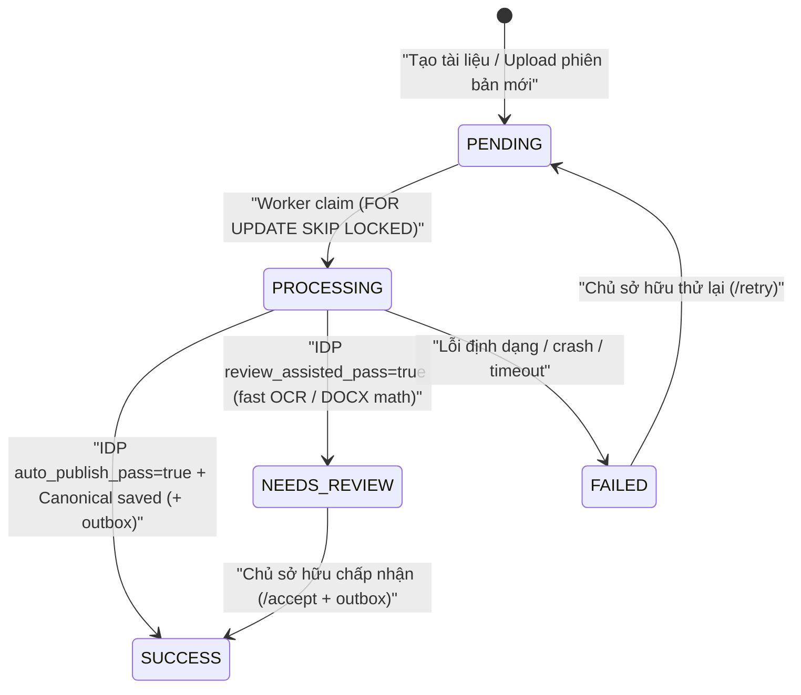

# Document Service — Thiết kế v1

**Trạng thái P0/P1:** `IMPLEMENTED — VERIFIED` · **Điều phối hoàn thiện & đối chiếu P0/P1/P2:** [CODEX_ORCHESTRATION.md](CODEX_ORCHESTRATION.md)

Thiết kế v1 dựa trên [ADR-002](../ADR-002-document-service.md). Tài liệu thiết kế tóm tắt gọi lớp trừu tượng lưu tệp là `BlobStore` (hiện thực là `StorageBackend` / `LocalVolumeStorage` với khóa `source/{document_id}/{version_id}` & `canonical/{document_id}/{version_id}.json`) và nhóm xử lý worker là `processing_jobs` (hiện thực P0/P1 gom cột claim/lease `attempt_count`, `available_at` cùng `FOR UPDATE SKIP LOCKED` + `pg_advisory_xact_lock` ngay trên `document.document_versions` trong tổng `7` bảng schema `document`, gồm thêm `audit_events`); phần Cloud Run / GCS / quota / malware scan / retention thuộc pha P2 tại [TASK-017I](../../../../tasks/TASK-017I-document-p2-cloud-and-governance.md).

Ngày 2026-11-21, suite Document trên PostgreSQL 16 đạt **`99 passed in 11.59s`**, gồm Alembic `upgrade head`/`downgrade base`, worker lease với `FOR UPDATE SKIP LOCKED`, IDP thật cho 5 định dạng, luồng `/accept`, H3 và H6/L6/O2. Compose smoke trên Docker Desktop 29.7.2 (linux) xác minh xử lý PDF 10 MB và role `document_svc` bị từ chối đọc `core.users`. Xem [TASK-017C](../../../../tasks/TASK-017C-document-idp-worker-and-review.md) và [TASK-017E](../../../../tasks/TASK-017E-compose-demo-and-deployment.md).

**Business Rules liên quan:** `B1`, `B2`, `B3`, `B4`, `B5`, `B6`, `B7`, `G5`, `H3`, `H6`, `L6`, `O1`, `O2`, `F5`, `F7`, `K2`, `QAS-01`, `QAS-02`, `QAS-04`, `QAS-10`.

---

## 1. Phạm vi, công nghệ và ranh giới

- **Dịch vụ độc lập trong monorepo:** `services/document/`, dùng Python 3.12, FastAPI, SQLAlchemy 2.x, Alembic.
- **Cơ sở dữ liệu:** sử dụng PostgreSQL 16 schema riêng `document` với DB role/credential riêng (không truy cập SQL, không tạo foreign key sang schema `core`).
- **Tác vụ nền (Worker):** chạy process riêng từ cùng Docker image (`python -m app.worker`), giống mô hình `notification-worker` của Core — **không** tạo thêm microservice thứ sáu. Worker thực hiện hai vòng lặp trên schema `document`: (1) xử lý IDP cho `document_versions` đang `PENDING` và (2) phát/xác nhận outbox events.
- **Tích hợp IDP:** dùng lại pipeline trong [services/rag/idp/ingest.py](../../../../services/rag/idp/ingest.py) và kiểm tra đầu vào tại [services/rag/idp/input/filetypes.py](../../../../services/rag/idp/input/filetypes.py). Document Service **không** chạy chunking, embedding hay BM25.
- **Lưu trữ tệp (`StorageBackend`):**
  - **P1 (Docker Compose demo bảo vệ):** lưu trên volume cục bộ (`DOCUMENT_STORAGE_PATH`) với cơ chế ghi tệp tạm rồi đổi tên nguyên tử (`atomic replace`) và đối chiếu `SHA-256`.
  - **P2 (cloud sau bảo vệ):** triển khai `GCSStorageBackend` + signed URL upload để vượt trần request body của Vercel Functions.

---

## 2. Giao tiếp xác thực và kiểm tra quyền với Core (Fail Closed)

Document Service **không giữ `SECRET_KEY` của Core**. Mọi xác thực người dùng và quyền lớp đi qua API nội bộ của Core với header `X-Service-Key` (`INTERNAL_SERVICE_SECRET`):

1. **Xác thực Bearer JWT (`POST /internal/v1/auth/introspect`):**
   - Document gửi `{"token": "<bearer_jwt>"}` sang Core (timeout nội bộ mặc định 3 giây; **không cache** kết quả trong P1).
   - Nếu `active != true` → trả `401 UNAUTHENTICATED`.
   - Nếu `user.school_id` là `null` trên thao tác yêu cầu phạm vi trường → từ chối `403 FORBIDDEN` hoặc `404 NOT_FOUND` (fail closed).
   - Nếu Core timeout / `5xx` / lỗi mạng → trả `503 SERVICE_UNAVAILABLE` (từ chối an toàn, không tự giải mã JWT cục bộ).
2. **Kiểm tra quyền theo lớp (`GET /internal/v1/classes/{class_id}/access?user_id=&action=`):**
   - **Chia sẻ / thu hồi tài liệu lớp:** dùng `action=manage_class_documents` (đòi hỏi lớp `ACTIVE`, cùng `school_id`, actor là `LECTURER` đang được phân công `PRIMARY` hoặc `ASSISTING`).
   - **Xem danh sách / đọc / tải nguồn tài liệu trong lớp:** dùng `action=read_document_source` **VÀ** xác minh `class_document_grants.is_active == true` **VÀ** `documents.deleted_at IS NULL` **VÀ** có `serving_version`.
   - **Ghi chú / bookmark cá nhân (H6, L6, O2):**
     - Tạo mới ghi chú hoặc toggle bookmark trong lớp: cần `read_document_source` + grant đang hoạt động + tài liệu chưa xóa. Chú ý: theo `classroom/public.py`, `read_document_source` cho phép thành viên/giáo viên hiện hành đọc trên cả lớp `ACTIVE` và `ARCHIVED` (O2 cho phép sửa/tạo ghi chú cá nhân đối với nguồn còn quyền trên lớp lưu trữ, đồng thời không cho chia sẻ/thu hồi grant mới vì `manage_class_documents` yêu cầu `ACTIVE`).
     - Đọc danh sách `/users/me/notes`, `/users/me/bookmarks` và sửa/xóa ghi chú đã có: **chỉ chủ sở hữu ghi chú (`note.user_id == actor.id`)**. Khi hiển thị, server kiểm tra quyền hiện hành cho từng `(class_id, document_id)` qua Core (`read_document_source`) và grant hiện hành (`is_active == true` và `deleted_at IS NULL`). Nếu một trong hai không còn hợp lệ: đặt `is_source_accessible = false` và **che `source_quote = null`** (giữ nguyên `note_text` tự viết theo H6/L6).
   - **Quy tắc ánh xạ mã lỗi từ quyết định bị từ chối của Core:**
     - `allowed == false` và `class_status == "ARCHIVED"` (với thao tác ghi cần `ACTIVE` như cấp/thu hồi grant) → `409 CONFLICT` (`Lớp học đã lưu trữ`).
     - `allowed == false` và `class_status is None` (lớp không tồn tại hoặc khác trường) → `404 NOT_FOUND` (che tài nguyên ngoài trường).
     - `allowed == false` và `class_status == "ACTIVE"` (người dùng không có quyền phù hợp) → `403 FORBIDDEN`.

---

## 3. Ma trận phân quyền tổng hợp

| Thao tác | Owner tài liệu (`LECTURER`) | Giáo viên phối hợp / Chính khác trong lớp (không phải owner) | Student có enrollment & grant | Admin |
|---|---|---|---|---|
| Xem thư viện riêng (`GET /documents`), tạo nguồn, sửa metadata, tải phiên bản mới, retry, chấp nhận `NEEDS_REVIEW`, xóa nguồn | Có | Không (`404`/`403`) | Không (`403`) | Không đọc thư viện riêng người khác |
| Chia sẻ tài liệu vào lớp | Có nếu được phân công (`manage_class_documents`) và tài liệu có `SUCCESS` | Không tự chia sẻ tài liệu riêng của giáo viên khác (MVP chỉ cho phép chia sẻ nguồn mình sở hữu; thu hồi được nguồn đang grant trong lớp) | Không (`403`) | Không mặc định |
| Thu hồi chia sẻ khỏi lớp (`DELETE /classes/{id}/documents/grants/{doc_id}`) | Có (`manage_class_documents`) | Có (`manage_class_documents`, theo Rule **B2**, **O1**) | Không (`403`) | Không mặc định |
| Đọc/tải tài liệu trong lớp | Có (`read_document_source` + active grant) | Có (`read_document_source` + active grant; không sửa/xóa nguồn) | Có (`read_document_source` + active grant) | Không (`404`/`403`) |
| Tạo/sửa/xóa ghi chú & bookmark của chính mình | Có (nếu có quyền đọc) | Có (nếu có quyền đọc) | Có (O2, H6, L6) | Không đọc/sửa ghi chú riêng của người dùng |

---

## 4. Mô hình dữ liệu logic (schema `document`, UUID PK, UTC `timestamptz`)

Các bảng dưới đây thuộc sở hữu hoàn toàn của Document Service trong schema `document`:

| Bảng | Các cột chính | Ràng buộc và chỉ mục quan trọng |
|---|---|---|
| `documents` | `id`, `school_id`, `owner_user_id`, `owner_display_name`, `title`, `description`, `format` (`PDF\|PPTX\|DOCX\|TXT\|MARKDOWN`), `deleted_at`, `created_at`, `updated_at` | `deleted_at` nullable cho soft-delete nhằm bảo toàn khóa ngoại lịch sử của `source_bound_notes` (H6/L6) và audit; mọi truy vấn tài liệu sống lọc `deleted_at IS NULL`. Index `(school_id, owner_user_id, deleted_at)`. |
| `document_versions` | `id`, `document_id` (FK `documents.id`), `version_number` (`int >= 1`), `original_filename`, `file_type`, `mime_type`, `file_size_bytes`, `source_sha256`, `storage_key`, `canonical_storage_key`, `canonical_sha256`, `canonical_schema_version`, `page_count`, `processing_status` (`PENDING\|PROCESSING\|SUCCESS\|NEEDS_REVIEW\|FAILED`), `acceptance_mode` (`AUTO_PUBLISHED\|OWNER_ACCEPTED\|null`), `accepted_by_user_id`, `accepted_at`, `review_summary_json` (JSONB), `error_code`, `error_message`, `attempt_count`, `available_at`, `created_at`, `updated_at` | `UNIQUE(document_id, version_number)`; `CHECK(file_size_bytes > 0)`; `CHECK(processing_status IN (...))`; index claim worker `(processing_status, available_at)`. |
| `class_document_grants` | `id`, `school_id`, `class_id`, `document_id` (FK `documents.id`), `granted_by_user_id`, `revoked_by_user_id`, `is_active`, `granted_at`, `revoked_at` | Partial unique `UNIQUE(class_id, document_id) WHERE is_active = true`; index `(class_id, is_active)`, `(document_id, is_active)`. |
| `source_bound_notes` | `id`, `school_id`, `user_id`, `class_id`, `document_id` (FK `documents.id`), `document_version_id` (FK `document_versions.id`, nullable), `version_number`, `locator`, `page_number`, `note_text`, `source_quote`, `created_at`, `updated_at` | Index `(user_id, class_id, document_id)`, `(user_id, updated_at DESC)`. Không cascade xóa ghi chú khi tài liệu bị xóa mềm (giữ H6/L6). |
| `document_bookmarks` | `id`, `school_id`, `user_id`, `class_id`, `document_id` (FK `documents.id`), `document_version_id` (FK `document_versions.id`, nullable), `version_number`, `locator`, `page_number`, `created_at` | `UNIQUE(user_id, class_id, document_id, locator)`. |
| `outbox_events` | `id`, `schema_version`, `event_type`, `aggregate_id`, `aggregate_version`, `payload_json`, `attempts`, `available_at`, `published_at`, `last_error_code`, `created_at` | Partial index `idx_doc_outbox_unpublished` trên `published_at IS NULL`. Ghi nguyên tử cùng transaction nghiệp vụ. |
| `audit_events` | `id`, `school_id`, `actor_id`, `action`, `target_type`, `target_id`, `correlation_id`, `metadata_json`, `occurred_at` | Metadata theo allowlist, **tuyệt đối không lưu nội dung tài liệu, trích dẫn hoặc ghi chú cá nhân**. |

---

## 5. Vòng đời phiên bản, quy tắc H3 và tính dẫn xuất `SUPERSEDED`

### Quy tắc phục vụ và dẫn xuất (Rule B4, H3, B6)
- **`serving_version`:** đối với một `document_id` (chưa bị xóa), là dòng `document_versions` có `processing_status = 'SUCCESS'` và `version_number` lớn nhất.
- **`is_serving`:** `true` duy nhất cho `serving_version.id`.
- **`is_superseded` (tính lúc đọc, không lưu DB):** `true` đối với các phiên bản có `processing_status = 'SUCCESS'` và `version_number < serving_version.version_number`. Trên giao diện Web, các bản này hiển thị là **"Bản lưu"**.
- **Fallback khi phiên bản mới lỗi hoặc chờ soát:** nếu v1 là `SUCCESS` và v2 đang `PENDING`, `PROCESSING`, `NEEDS_REVIEW` hoặc `FAILED`, `serving_version` vẫn là **v1**; học sinh tiếp tục đọc v1 bình thường.
- **Ưu tiên thu hồi (Rule B6, H3):** nếu `ClassDocumentGrant` bị thu hồi (`is_active = false`) hoặc tài liệu bị xóa (`deleted_at IS NOT NULL`), mọi quyền đọc/tải/truy hồi đều bị chặn ngay lập tức, **không** fallback về phiên bản cũ.

---

## 6. Kiểm tra tệp tải lên, Worker IDP và ranh giới Canonical

### 6.1. Kiểm tra đầu vào (Ingress) và hạn mức P1
- **Chính sách P1 (cấu hình qua env, mặc định):**
  - `DOCUMENT_MAX_SIZE_BYTES = 20_971_520` (**20 MB**).
  - `DOCUMENT_MAX_PAGES = 300` (**300 trang** PDF / slide PPTX).
  - 5 định dạng hợp lệ: `PDF` (`.pdf`), `PPTX` (`.pptx`), `DOCX` (`.docx`), `TXT` (`.txt`), `MARKDOWN` (`.md`, `.markdown`).
- **Kiểm tra trước khi lưu phiên bản `PENDING`:**
  1. Từ chối tệp rỗng (`0 bytes`) hoặc vượt `max_size_bytes` (`413 PAYLOAD_TOO_LARGE`).
  2. Kiểm tra phần mở rộng + **magic-byte sniffing** (`%PDF-`, `PK\x03\x04` kèm kiểm tra entry `word/document.xml` cho DOCX hoặc `ppt/presentation.xml` cho PPTX, text decode hợp lệ cho TXT/Markdown) — từ chối file giả mạo phần mở rộng (`DOC-T04`).
  3. **Chống ZIP-bomb** cho DOCX/PPTX: giới hạn tổng dung lượng giải nén (ví dụ `<= 100 MB`), số lượng entry (`<= 2.000`), và tỷ lệ nén bất thường trước khi đưa vào parser.
  4. **Kiểm tra PDF trước khi xếp hàng:** từ chối PDF đặt mật khẩu/mã hóa (`ENCRYPTED_PDF`), PDF 0 trang (`EMPTY_DOCUMENT`) hoặc vượt `300` trang (`PAGE_LIMIT_EXCEEDED`), trả `422 VALIDATION_ERROR`.
  5. Ghi tệp gốc xuống `StorageBackend` theo đường dẫn sinh ngẫu nhiên (không dùng nguyên tên tệp người dùng để tránh path traversal), tính `source_sha256`, rồi commit bản ghi `document_versions` trạng thái `PENDING`.

### 6.2. Thực thi IDP trong Worker và ánh xạ kết quả
1. Worker chọn 1 phiên bản `PENDING` (hoặc `PROCESSING` bị treo quá `LEASE_TIMEOUT`) bằng `SELECT ... FOR UPDATE SKIP LOCKED`.
2. Gọi `idp.ingest.ingest_file(..., limits=InputLimits(max_bytes=20_971_520, max_pages=300))` trên thư mục làm việc tạm cô lập.
3. Khi trích xuất thành công cấu trúc Canonical (ghi rõ `canonical_schema_version` từ `canonical["schema_version"]` — hiện tại `services/rag/idp/canonical.py` xuất `idp-canonical-1`; nếu tích hợp Unified publisher thì là `idp-canonical-2`):
   - Lưu bền vững `canonical.json` + các asset hình ảnh/outline projection vào `StorageBackend` trước khi cập nhật DB (`canonical_storage_key`, `canonical_sha256`).
   - Đọc cờ đánh giá từ báo cáo ingestion (`report.json` / `ingestion_report.json`):
     - Nếu `ingestion_auto_publish_pass == True`: cập nhật `processing_status = 'SUCCESS'`, `acceptance_mode = 'AUTO_PUBLISHED'`, đồng thời ghi outbox event `document.version.published` trong cùng transaction.
     - Nếu `ingestion_review_assisted_pass == True` nhưng `ingestion_auto_publish_pass == False` (ví dụ có `FAST_OCR_REVIEW`, `FALLBACK_ENGINE_REVIEW`, công thức/bảng DOCX cần rà soát): cập nhật `processing_status = 'NEEDS_REVIEW'` và lưu tóm tắt mã cờ vào `review_summary_json` (chủ sở hữu có thể kiểm tra và bấm **Chấp nhận** để lên `SUCCESS`).
     - Trường hợp còn lại: đặt `processing_status = 'FAILED'` với mã lỗi/thông điệp an toàn (không lộ stack trace).
4. **Phục hồi lỗi (`QAS-10`, `FT-05`):** nếu worker crash giữa chừng trước khi commit `SUCCESS`, không có bản ghi `SUCCESS` hay outbox `document.version.published` nào được phát ra; phiên bản cũ (nếu có) vẫn nguyên vẹn; khi lease hết hạn hoặc retry, worker xử lý lại an toàn.

`_finish_version` trong `services/document/app/modules/versions/processing.py` giữ advisory lock và cập nhật trạng thái trong cùng session và transaction, loại bỏ rollback của savepoint lồng nhau trên PostgreSQL 16.

---

## 7. Hợp đồng sự kiện Outbox (Document → AI)

Mọi sự kiện trong `document.outbox_events` chỉ chứa định danh, phiên bản, checksum và URI nội bộ — **không chứa nội dung văn bản tài liệu, trích dẫn hoặc dữ liệu người dùng nhạy cảm**:

| `event_type` | `aggregate_id` | `payload_json` tối thiểu | Khi nào phát |
|---|---|---|---|
| `document.version.published` | `document_id` | `{event_id, schema_version: 1, school_id, document_id, version_id, version_number, canonical_schema_version, canonical_sha256, acceptance_mode}` | Cùng transaction khi phiên bản đạt `SUCCESS` (từ worker hoặc `/accept`) |
| `document.grant.changed` | `class_id` | `{event_id, schema_version: 1, school_id, class_id, document_id, is_active, changed_at}` | Cùng transaction khi `POST` hoặc `DELETE` grant lớp |
| `document.deleted` | `document_id` | `{event_id, schema_version: 1, school_id, document_id, revoked_class_ids, deleted_at}` | Cùng transaction khi xóa tài liệu nguồn |

AI Service tiêu thụ các sự kiện này (hoặc đối soát định kỳ qua `GET /internal/v1/classes/{class_id}/documents/active-grants` và `GET /internal/v1/documents/{document_id}/versions/{version_id}/canonical`) để lập chỉ mục bất đồng bộ. Nếu outbox consumer hoặc AI Service chậm/ngừng, Document Service và người dùng vẫn tải lên, đọc và chia sẻ tài liệu bình thường (`QAS-01`, `QAS-02`).

---

## 8. Kiểm thử bắt buộc trước nghiệm thu G3

Bao phủ đầy đủ bộ ca kiểm thử tại [17_Test_Cases.md](../../lumi-design/17_Test_Cases.md#document-service--future-proposal) và mở rộng theo ADR-002:
- `DOC-T01..DOC-T13`: owner library, cảnh báo xóa đa lớp (`confirm_multi_class`), đủ 5 định dạng (`PDF`, `PPTX`, `DOCX`, `TXT`, `MARKDOWN`), từ chối file rỗng/giả mạo MIME/ZIP-bomb/mã hóa/`>20 MB`/`>300 trang`, fallback phiên bản cũ khi bản mới `FAILED` hoặc `NEEDS_REVIEW`, `ASSISTING` không được sửa/chấp nhận nguồn của người khác, mất assignment bị chặn ngay, thu hồi grant hiệu lực tức thì, cross-school che bằng `404`, Core unavailable fail closed (`503`), `SourceBoundNote` owner-only + che `source_quote` theo H6/L6 + sửa trên lớp `ARCHIVED` theo O2.
- Kiểm thử bổ sung cho ADR-002:
  - Luồng `NEEDS_REVIEW → OWNER_ACCEPTED → SUCCESS` phát đúng 1 sự kiện `document.version.published`; đồng giáo viên/học sinh gọi `/accept` bị chặn; gọi `/accept` trên `FAILED`/`PENDING` bị `409`.
  - Revoked JWT (`session_version` tăng sau `logout-all`) bị chặn `401` ngay lập tức tại Document.
  - Crash worker giữa chừng (`QAS-10 / FT-05`) không tạo phiên bản `SUCCESS` hoặc event `document.version.published` dở dang.
