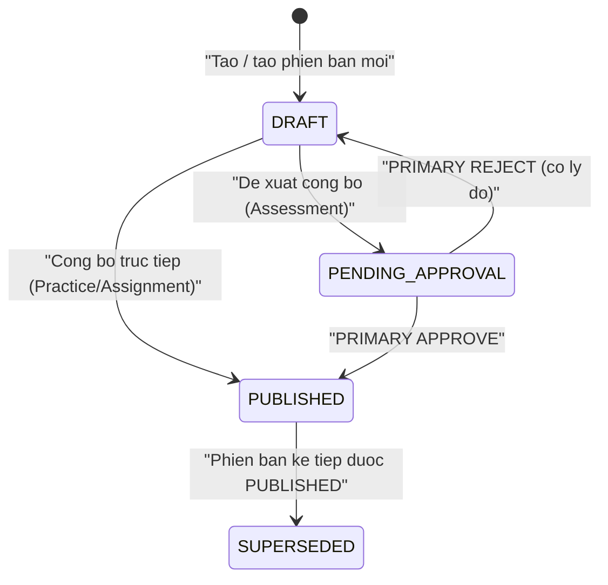
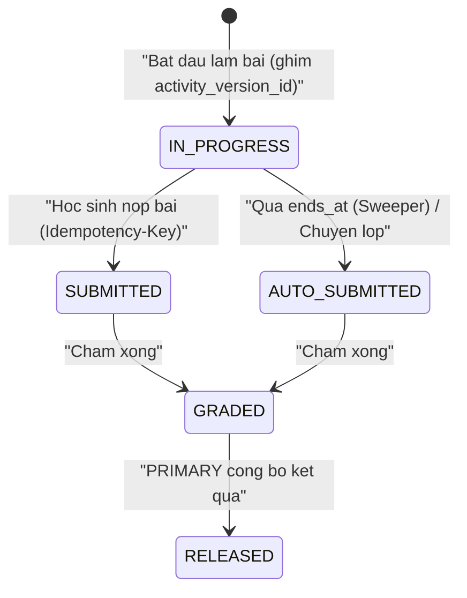

# Learning Service — Thiết kế v1

**Trạng thái:** `IMPLEMENTED` · **Cập nhật:** 2026-11-22

> **Phạm vi và giới hạn nghiệm thu:** Mã nguồn `services/learning/` (L0–L4: Practice, Official Assessment, Assignment, Grading/Corrections, Appeals, Scoring Adjustments M4, D6 Assessment Lock, Deadline & Notification Outbox Sync) đã được triển khai, tích hợp qua Web proxy `/api/learning/v1/*` và đóng gói trong Docker Compose (`compose.full.yaml`). Nghiệm thu tải quy mô đầy đủ `QAS-03` (`1.000` tình huống) và `QAS-05` theo `TP-01` trên môi trường tách biệt vẫn là gate đo đạc vận hành.

**Business Rules liên quan:** `D0`, `D1`, `D2`, `D3`, `D4`, `D5`, `D6`, `D7`, `D8`, `I1`, `I2`, `I3`, `I4`, `I5`, `I6`, `I7`, `L2`, `L3`, `M1`, `M2`, `M3`, `M4`, `O3`, `O4`, `O5`, `QAS-03`, `QAS-05`.

---

## 1. Phạm vi, công nghệ và ranh giới

- **Dịch vụ độc lập trong monorepo:** `services/learning/`, sử dụng Python 3.12, FastAPI, SQLAlchemy 2.x, Alembic.
- **Cơ sở dữ liệu:** PostgreSQL 16 schema riêng `learning` (`learning.alembic_version`, 4 migrations: `0001_initialize_learning_schema.py` → `0004_grades_appeals_adjustments.py`). Không truy cập SQL hay tạo khóa ngoại sang schema của Core, Document hoặc AI.
- **Lưu trữ tệp bài tập (`BlobStore`):** sử dụng `LocalFsBlobStore` lưu tệp tải lên của học sinh tại `BLOB_STORAGE_DIR` (trong Docker Compose là volume `learning_blobs:/var/lib/learning-blobs`, giới hạn mặc định `ASSIGNMENT_MAX_UPLOAD_BYTES = 26_214_400` byte = 25 MiB).
- **Runtime & bảo mật container:** chạy dưới user non-root UID `10003`, root filesystem chỉ đọc (`read_only: true`, `/tmp` dùng `tmpfs`, drop toàn bộ Linux capabilities), cổng `8003`.
- **Tác vụ nền (`background_worker.py`):** chạy chu kỳ mỗi `SWEEPER_INTERVAL_SECONDS` (mặc định 10 giây):
  1. `sweep_expired_attempts`: tự động nộp các lượt `assessment_attempts` đang `IN_PROGRESS` đã quá hạn `ends_at` (`AUTO_SUBMITTED`, `submit_reason = "TIMEOUT"`, Rule `I2`).
  2. Chuyển phát `outbox_events` (`SKIP LOCKED`, backoff tối đa 300 giây) sang Core: đồng bộ deadline `calendar.deadline.upsert` (`PUT /internal/v1/calendar/learning-deadlines`) và phát thông báo `ASSESSMENT_RESULT_RELEASED`, `GRADE_PROPOSAL_PENDING`, `APPEAL_RESOLVED` (`POST /internal/v1/notifications/learning-events`).
  3. `discard_expired_uploads`: dọn các tệp upload nháp (`assignment_uploads`) đã quá hạn mà chưa gắn vào bản nộp chính thức.

---

## 2. Quyền và quy tắc nghiệp vụ cốt lõi

1. **Xác thực & phân quyền qua Core (Fail Closed):**
   - Kiểm tra Bearer JWT (`CORE_JWT_SECRET`) kết hợp `GET /api/v1/users/me` và kiểm tra quyền lớp qua `GET /internal/v1/classes/{class_id}/access` với các action: `participate_current_class`, `read_class_content`, `read_own_history`, `grade_submitted_work`.
   - Ánh xạ lỗi từ chối từ Core: lớp `ARCHIVED` trả `409 CLASS_ARCHIVED` cho thao tác ghi mới; lớp không tồn tại/khác trường (`class_status is None`) trả `404`; thiếu quyền ở lớp `ACTIVE` trả `403`.
2. **Tách biệt Luyện tập và Điểm chính thức (`D0`, `D3`, `D8`):**
   - `practice_attempts` và `practice_answers` lưu tách biệt hoàn toàn với `grades` và `grade_revisions`. Điểm luyện tập không bao giờ đi vào bảng điểm chính thức.
3. **Phân quyền Giáo viên Chính (`PRIMARY`) và Giáo viên Phối hợp (`ASSISTING`) (`D1`, `D4`, `I6`, `M2`, `M4`):**
   - Mọi câu hỏi phải được duyệt (`reviewed = true`) trước khi công bố hoạt động (`D1`).
   - `PRIMARY` và `ASSISTING` đều có thể tạo nháp Practice/Assessment/Assignment, duyệt câu hỏi nháp và chấm bài theo `grade_submitted_work`.
   - **Chỉ `PRIMARY`** được phép phê duyệt công bố Assessment (`POST .../decision`), công bố kết quả (`POST .../release-results`), duyệt/từ chối đề xuất sửa điểm (`POST /grade-revisions/{id}/decision`) và duyệt điều chỉnh điểm cho câu hỏi lỗi (`POST /scoring-adjustments/{id}/decision`). Không cho phép tự phê duyệt đề xuất của chính mình.
   - `ADMIN` chỉ có thể can thiệp sửa điểm ngoại lệ khi cung cấp header `X-Admin-Reason` hợp lệ (`ADMIN_INTERVENTION | POLICY_VIOLATION | USER_REQUEST`), được ghi vào `audit_events`.
4. **Phiên bản bất biến & điều chỉnh đề lỗi (`I4`, `O3`, `M4`):**
   - Khi công bố (`PUBLISHED`), `activity_versions` đóng băng `content_snapshot_json` và `content_sha256`. Mọi lượt làm bài đều ghim `activity_version_id`. Tạo phiên bản mới sinh `version_number + 1` ở trạng thái `DRAFT`.
   - Nếu câu hỏi trong phiên bản đã công bố có sai sót, giáo viên đề xuất `ScoringAdjustment` (`VOID_QUESTION`, `GRANT_FULL_CREDIT`, `ACCEPT_ADDITIONAL_KEY`) để `PRIMARY` phê duyệt mà không làm biến đổi đề thi gốc.
5. **Chống nộp trùng và tự phục hồi (`I1`, `I2`, `QAS-03`):**
   - Thao tác nộp Assessment (`POST .../submit`) và Assignment (`POST .../submissions`) yêu cầu header `Idempotency-Key` khớp với `operation_id` trong body (khóa duy nhất trên DB) kèm endpoint `/reconcile` để đối soát biên nhận khi mất kết nối mạng.
6. **Chuyển lớp, quyền lịch sử & D6 Assessment Lock (`D6`, `M1`, `O4`):**
   - Hành vi khi học sinh có bài kiểm tra đang làm dở khi chuyển lớp được cấu hình qua `TRANSFER_PENDING_ATTEMPT_POLICY` (`allow_finish_until_ends_at` mặc định hoặc `auto_submit_on_transfer`).
   - Học sinh đã kết thúc ghi danh vẫn xem được kết quả đã công bố của mình (`GET /history/results/{result_id}`) và gửi phúc khảo (`POST /classes/{class_id}/appeals`) trong thời hạn `DEFAULT_APPEAL_WINDOW_DAYS` (mặc định 7 ngày) thông qua quyền `read_own_history`.
   - Route nội bộ `GET /internal/v1/assessment-lock` báo `active_official_assessment = true` khi học sinh có bất kỳ lượt Assessment `IN_PROGRESS` nào chưa hết hạn trong trường, giúp AI Service chặn hỏi Tutor trong lúc thi (`D6`).

---

## 3. Giao tiếp liên service

| Dịch vụ | Chiều gọi | Mục đích & Cơ chế |
|---|---|---|
| **Core** | Learning → Core | Xác thực phiên (`/users/me`), kiểm tra quyền lớp (`/internal/v1/classes/{id}/access`), đẩy lịch deadline (`PUT /internal/v1/calendar/learning-deadlines`), đẩy sự kiện thông báo (`POST /internal/v1/notifications/learning-events`). |
| **Document** | Learning → Document | Gọi `GET /internal/v1/classes/{id}/documents/active-grants` khi tải editor/attempt/assignment để gắn nhãn tài liệu còn quyền hay đã thu hồi. |
| **AI** | Learning → AI | Gọi `POST /internal/v1/explain-mistake` (cho Practice) và `POST /internal/v1/assignment/grade-hint` (cho Assignment grading — mang tính tư vấn, AI không tự chấm điểm `D5`). |
| **AI** | AI → Learning | Gọi `GET /internal/v1/assessment-lock` (`D6`) và `POST /internal/v1/quiz-items/import` (xuất câu hỏi AI đã duyệt vào `question_items`). |
| **Learner Intelligence (đề xuất)** | LI → Learning | Gọi `GET /internal/v1/classes/{id}/grades/confirmed` (`LEARNING_ANALYTICS_SERVICE_SECRET`) để lấy điểm chính thức đã xác nhận theo phân trang. |

---

## 4. Mô hình dữ liệu logic (schema `learning`, 18 bảng, UUID PK, UTC `timestamptz`)

| Nhóm | Bảng | Vai trò & Ràng buộc chính |
|---|---|---|
| Ngân hàng & Hoạt động | `question_items`, `activities`, `activity_versions`, `activity_audience`, `due_overrides` | Lưu ngân hàng câu hỏi (thủ công/nhập từ AI có `UNIQUE(ai_draft_id)`), hoạt động `PRACTICE\|ASSESSMENT\|ASSIGNMENT`, các phiên bản `UNIQUE(activity_id, version_number)`, danh sách học sinh được giao bài tập và gia hạn hạn nộp. |
| Luyện tập (`D8`) | `practice_attempts`, `practice_answers` | Lưu lượt luyện tập và câu trả lời kiểm tra tức thì (`UNIQUE(attempt_id, question_id)`), tách biệt hoàn toàn khỏi `grades`. |
| Đánh giá chính thức | `assessment_attempts`, `attempt_answers` | Lưu lượt làm bài có giới hạn thời gian (`UNIQUE(activity_id, student_id, attempt_number)`, `UNIQUE(submit_operation_id)`), partial index trên `status = 'IN_PROGRESS'` phục vụ check `D6` và sweeper hết giờ. |
| Bài tập nộp tệp | `assignment_uploads`, `assignment_submissions` | Lưu tệp upload nháp có hạn `expires_at` và các lần nộp bài (`UNIQUE(activity_id, student_id, submission_number)`, `UNIQUE(operation_id)`). |
| Điểm, Điều chỉnh & Phúc khảo | `grades`, `scoring_adjustments`, `grade_revisions`, `appeals` | `grades` giữ điểm chính thức duy nhất theo `(target_type, target_id)` trỏ tới `effective_revision_id`; `grade_revisions` lưu chuỗi lịch sử phiên bản điểm (`UNIQUE(grade_id, version)`); `scoring_adjustments` xử lý đề sai (`M4`); `appeals` theo dõi phúc khảo (`OPEN\|PROPOSED\|RESOLVED`). |
| Hạ tầng nội bộ | `audit_events`, `idempotency_records`, `outbox_events` | Ghi audit không chứa nội dung đáp án/chat (`K5`), lưu khóa idempotency 24h và hàng đợi outbox đồng bộ sang Core. |

---

## 5. Vòng đời phiên bản hoạt động & lượt làm bài chính thức

